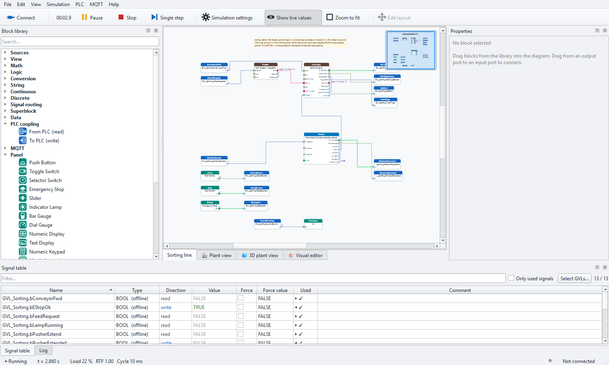
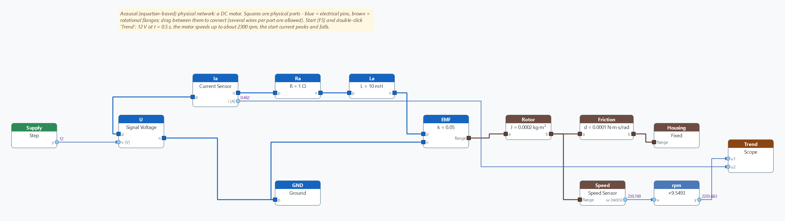
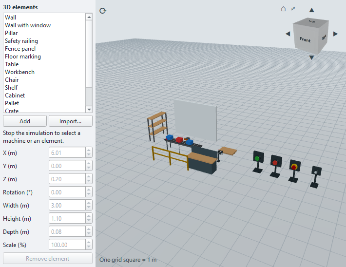

# Saunata

**Plant simulation and virtual commissioning for PLCs.**

Saunata simulates the machine or process that a PLC program controls, such as conveyors, cylinders, tanks, lifts,
motors and operator panels. It connects the simulated plant to a real or virtual PLC, so you can test the PLC
code before the real machine exists. It was made at HAMK for PLC courses and for virtual-commissioning engineers.

* Connections: **Beckhoff TwinCAT 3 over ADS** and **MQTT**
* Models: **block diagrams** and **acausal (equation-based) physical networks**
* Runs on Windows 10 / 11 and needs **no administrator rights, no Python and no TwinCAT**
* User interface in **English and Finnish**

**[⬇ Download the latest version](https://github.com/nghia-vo-1201/saunata-releases/releases/latest)**:
get `Saunata-<version>-Setup.exe` from the release's *Assets*.

---

## What you can do with it

### Connect to a PLC
* **TwinCAT 3.1 Build 4024 and 4026**: the local XAR runtime, **UmRT** (user-mode runtime) and real PLCs (CX, IPC).
* It works through the installed TwinCAT router, or **standalone without any TwinCAT installation** (direct
  ADS/AMS over TCP, with route creation built in).
* Every cycle it reads all global variables of the GVLs you choose (structures and arrays are expanded) and writes
  the simulated sensor values back. Online changes in the PLC are detected automatically.
* A **signal table** shows every signal and lets you force values. The **GVL generator** writes the matching
  variable declarations for your TwinCAT project.
* A built-in **mock PLC** lets you try the ADS coupling with no PLC and no TwinCAT at all.

### Build the plant model
* **About 250 blocks**: sources, math, logic, IEC timers and counters, conversions, continuous and discrete
  systems (transfer function, state space, PID, ...), physics, electrical drives, pneumatics, hydraulics, process
  valves, sensors and I/O terminals, conveyors, elevator, escalator, rolling door, traffic lights.
* **Operator panel** elements: push buttons, switches, emergency stop, lamps, gauges, text display, numeric and
  matrix keypads.
* **Physical networks**: electrical, translational, rotational and thermal components (resistors, capacitors,
  inductors, diodes, motors, masses, springs, inertias, gears, heat capacitors, convection, radiation, ...). You
  wire them like the real system and Saunata solves the equations.
* **Superblocks** to group parts of a model, and **FMU import** (FMI 2.0 / 3.0).
* **Your own blocks** in Python. The **Visual editor** lets you change a block's code, ports, parameters and its
  animated picture, all inside the app.

### See the plant move
* An animated, interactive **2D plant view**: press the buttons on the panel and watch boxes run along the conveyor.
* A **3D plant view** with walls, fences, tables, shelves and other surroundings. You can also import your own
  3D models (.glb, .gltf, .obj, .ply, .stl, .fbx).
* **Scopes and XY graphs** with CSV export.

### MQTT
* Models can exchange data as MQTT messages: *MQTT In → JSON Get → model → JSON Build → MQTT Out*.
* Several brokers per project and TLS are supported. Passwords are stored encrypted for your Windows user, never in
  the project file.
* A built-in **MQTT test broker** is included for lessons and tests.

### Learn it: Saunata Academy
A built-in course (*Help → Saunata Academy*) takes you from beginner to advanced level, with lessons, quizzes, labs
and certificates, in English and Finnish.

---

## Install

1. Open the **[latest release](https://github.com/nghia-vo-1201/saunata-releases/releases/latest)** and download
   `Saunata-<version>-Setup.exe`.
2. Run it. The installer is not code-signed, so Windows SmartScreen may say *"Windows protected your PC"*. Click
   **More info → Run anyway**.
3. Choose **Install for me only**. This needs no administrator rights.
4. Click **Install**, then **Finish**.

**System requirements:** Windows 10 or 11 (64-bit) and about 200 MB of free disk space.
*Optional:* TwinCAT 3.1 (4024 / 4026), a TwinCAT runtime or a Beckhoff CX / IPC to connect to a real PLC, and an
MQTT broker for MQTT connections. Simulations without a PLC need no other software.

**Updates:** Saunata checks for new versions by itself and installs one when you click *Install now*, or use
*Help → Check for updates...*. Your projects, your own blocks and your settings are kept.

---

## First steps

| Try | How |
|---|---|
| A simulation without a PLC | *File → Open example → Tank Level PID offline*, press **F5** |
| The ADS coupling without TwinCAT | Start menu → *Saunata mock PLC*, then *File → Open example → Demo Mock PLC*, press **F7** (connect) and **F5** |
| A physical network | Open *Physical DC Motor and RC* or *Thermal Room Heating*, press **F5** |
| MQTT | *MQTT → Test broker... → Start*, open *MQTT Tank Demo*, press **F5** |
| A real TwinCAT PLC | *PLC → Connection...*: enter the PLC's AMS Net ID and port 851, press *Test* (step-by-step in the user guide, chapter "Connecting to TwinCAT") |

Other examples: conveyor sorting station, pneumatic station, hydraulic press, 4-floor elevator, escalator, door and
traffic lights, lift and conveyor loop, control basics, FMU.

The full **user guide** opens in the app with **F1**. It includes a Finnish quick start (*Pikaopas suomeksi*).

---

## Suomeksi lyhyesti

Saunata on laitossimulaattori PLC-ohjelmien testaukseen ja virtuaaliseen käyttöönottoon. Se liittyy Beckhoff
TwinCAT 3 -PLC:hen (ADS) tai MQTT:n kautta. Mallit rakennetaan lohkokaavioina ja fysikaalisina verkkoina, ja
laitos näkyy animoituna 2D- ja 3D-näkymänä.

1. Lataa `Saunata-<versio>-Setup.exe` [uusimmasta julkaisusta](https://github.com/nghia-vo-1201/saunata-releases/releases/latest).
2. Jos SmartScreen varoittaa: *Lisätietoja → Suorita silti*.
3. Valitse *Asenna vain minulle* (ei vaadi järjestelmänvalvojan oikeuksia).
4. Kokeile: *Tiedosto → Avaa esimerkki → Tank Level PID offline* ja paina **F5**.
5. Ohjeet ohjelmassa: **F1**. Saunata Academy -kurssi löytyy Ohje-valikosta.

Pythonia, TwinCATia tai järjestelmänvalvojan oikeuksia ei tarvita.

---

## About this repository

This repository holds the **released installers** of Saunata, one GitHub release per version with its patch
notes. Saunata's built-in updater reads new versions from here.

**Author:** Nghia Vo, HAMK Häme University of Applied Sciences. Built with Claude Code by Anthropic.
